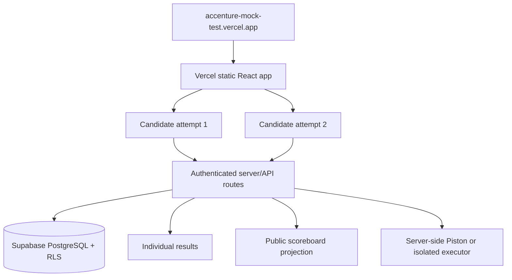

# Deployment architecture

Target URL: `https://accenture-mock-test.vercel.app`

## Current state

- The local frontend and production build are working.
- With `VITE_API_ENABLED=true`, new attempts and technical submissions use the Vercel API and Supabase timestamps; with it disabled, the local demo stores attempts in browser `localStorage`.
- Supabase schema, RLS policies, and the score-only `public.public_leaderboard` view are present in `supabase/migrations/202610110001_forge45_schema.sql`.
- Vercel routes now exist at `/api/attempts`, `/api/technical-questions`, `/api/leaderboard`, and `/api/coding-submissions`.
- `vercel.json` provides SPA fallback routing so refreshing a deployed screen does not return a Vercel 404.
- `https://accenture-mock-test.vercel.app` currently returns 404 because no Vercel deployment is authenticated from this workspace.

## Publish steps

1. In Vercel, import the repository and set the project root to `app`.
2. Build command: `npm run build`.
3. Output directory: `dist`.
4. Apply the Supabase migration and seed `technical_questions` server-side.
5. Add Vercel variables: `VITE_API_ENABLED=true`, `VITE_API_BASE_URL=/api`, `SUPABASE_URL`, and `SUPABASE_SERVICE_ROLE_KEY`. Keep the service-role key server-only.
6. Seed `technical_questions` from `data/questions.json` through a server-only script. Do not ship `answer_index` to the browser; the current local fallback still contains answer data and is not the production security mode.
7. Configure the public leaderboard route to read only `public.public_leaderboard`.
8. Install and configure an isolated Piston/self-hosted executor before enabling coding submissions. The current route fails closed with HTTP 503/501.
9. Redeploy and share the Vercel URL.

## Cloud security boundary

The production browser must never receive answer keys, official coding solutions, hidden test cases, or service-role credentials. The migration's public leaderboard view exposes only candidate display name, technical score, coding task count, and overall percentage. The technical API route is sanitized, but the existing offline fallback data import still needs to be split into public questions before public production use. The current coding route fails closed until a server-side sandbox is connected.
